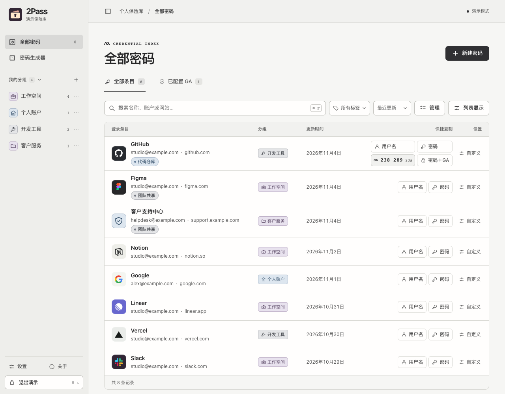

<div align="center">

# 🔐 2Pass

**使用 Tauri 和 React 构建的安全、现代化密码管理器**

[](https://github.com/yourusername/2pass)
[](LICENSE)
[](https://tauri.app/)
[](https://react.dev/)

[English](README.md) | [简体中文](README_CN.md)



</div>

---

## ✨ 功能特点

- 🔒 **AES-256-GCM 加密** - 使用业界标准的加密算法保护你的数据
- 🔑 **主密码保护** - 使用 Argon2 哈希算法保护主密码
- 📝 **完整的 CRUD 操作** - 添加、编辑、删除和查看密码条目
- 🔍 **实时搜索** - 快速搜索标题、用户名或网址
- 🎯 **拖动排序** - 在「排序 → 手动拖动」下直接拖动条目左侧手柄。也可按名称、更新或创建时间排序，选择会在重新打开后保留。
- 🎲 **密码生成器** - 生成强密码，可自定义长度和字符类型
- ⏱️ **TOTP 支持** - 集成 Google Authenticator，支持二次验证码
- 🔗 **组合密码** - 在详情中单独复制验证码或组合密码
- 📋 **一键复制** - 快速复制用户名、密码和组合密码到剪贴板
- 👁️ **密码显示/隐藏** - 控制密码的可见性
- 💾 **本地存储** - 所有数据加密存储在本地
- 🎨 **现代化 UI** - 美观且易用的用户界面
- 🌈 **多主题支持** - 瓷白、曜黑、黑金和雾玫瑰四种配色
- 📱 **响应式设计** - 可折叠的侧边栏，支持多视图切换
- 👥 **分组管理** - 使用自定义分组整理密码

## 🚀 快速开始

### 前置要求

- [Node.js](https://nodejs.org/) (20.19+ 或 22.12+)
- [pnpm](https://pnpm.io/) (或 npm/yarn)
- [Rust](https://www.rust-lang.org/) (Tauri 依赖)

### 安装

```bash
# 克隆仓库
git clone https://github.com/yourusername/2pass.git
cd 2pass

# 安装依赖
pnpm install
```

### 开发

```bash
# 启动开发服务器
pnpm tauri dev
```

只预览界面时可运行 `pnpm dev`，在浏览器中打开终端显示的本地地址。演示库使用临时样例，退出或刷新后重置，不会访问桌面保险库。

### 构建

```bash
# 构建生产版本
pnpm tauri build
```

构建完成后，可执行文件将位于 `src-tauri/target/release/bundle/` 目录下。

## 📖 使用说明

### 首次使用

1. **创建主密码**
   - 首次启动应用时，创建一个主密码（至少 8 个字符）
   - ⚠️ 请务必记住主密码，丢失后无法恢复！

2. **添加密码条目**
   - 点击「新建密码」
   - 填写标题、用户名、密码等信息
   - 可以选择「生成密码 → 使用此密码」直接填入
   - 标题旁的「图标与配色」可更换图标或随机选择低饱和色。分组可选固定颜色，同名标签会自动使用一致的颜色。

3. **管理密码**
   - 👁️ 查看密码
   - 📋 复制用户名或密码
   - ✏️ 编辑条目
   - 🗑️ 删除条目

4. **搜索密码**
   - 使用顶部搜索框快速查找密码
   - 支持搜索标题、用户名和网址

5. **配置 TOTP（可选）**
   - 新建或编辑密码时，展开「更多详情」，点击「添加 TOTP」
   - 生成或输入 TOTP 密钥
   - 使用 Google Authenticator 扫描二维码
   - 已配置的条目默认显示六位 GA 验证码。「密码＋GA」会在复制时生成当前验证码，并直接接在密码后面。
   - 点击行末「自定义」，可为该账号改成 GA 在前或另选分隔符。「列表显示」可以设置全局默认或隐藏验证码数字。

6. **使用分组整理**
   - 创建自定义分组来整理密码
   - 在条目详情的「分组」中移动密码
   - 按分组筛选密码

## 🔐 安全性

- **加密算法**: AES-256-GCM (认证加密)
- **密钥派生**: Argon2id (内存困难型哈希函数)
- **数据存储**: 所有敏感数据都经过加密后存储在本地
- **无云同步**: 所有数据仅保存在本地，不会上传到任何服务器

## 🛠️ 技术栈

### 前端
- **React 19** - UI 框架
- **TypeScript** - 类型安全
- **Vite** - 构建工具
- **DnD Kit** - 拖放功能

### 后端
- **Tauri 2.0** - 桌面应用框架
- **Rust** - 系统编程语言
- **aes-gcm** - AES-GCM 加密
- **argon2** - 密码哈希
- **totp-lite** - TOTP 验证码生成
- **uuid** - 唯一标识符

## 📁 项目结构

```
2pass/
├── src/                      # React 前端源码
│   ├── components/          # React 组件
│   ├── styles/             # CSS 样式文件
│   ├── hooks/              # 自定义 Hooks
│   ├── types.ts            # TypeScript 类型定义
│   └── App.tsx             # 主应用组件
├── src-tauri/               # Tauri 后端
│   ├── src/
│   │   ├── lib.rs          # Rust 核心逻辑
│   │   └── main.rs         # Tauri 入口
│   ├── Cargo.toml          # Rust 依赖配置
│   └── tauri.conf.json     # Tauri 配置
└── .github/
    └── workflows/          # GitHub Actions
```

## 🎨 主题

登录页和「设置 → 外观设置」都可以切换主题。瓷白以石墨色呈现操作，曜黑采用中性炭黑，黑金在暖黑底色上用香槟金勾勒细节，雾玫瑰搭配灰粉与酒红。选择会保留到下次启动和锁屏。

## 📦 下载

### 预编译版本

下载适合你平台的最新版本：

- **macOS 13.3+ (Apple Silicon / Intel)**: `2Pass_1.2.3_universal.dmg`
- **Windows**: `2Pass_1.2.1_x64-setup.exe` 或 `.msi`
- **Linux**: `2pass_1.2.1_amd64.deb` 或 `.AppImage`

[下载最新版本 →](https://github.com/yourusername/2pass/releases)

## ⚠️ 重要提示

1. **主密码无法恢复** - 请妥善保管！
2. **定期备份** - 建议定期导出数据
3. **生产环境** - 在生产环境使用时，建议修改 `lib.rs` 中的固定盐值

## 📝 数据存储位置

加密的数据文件存储位置：

- **macOS**: `~/Library/Application Support/com.twopass.password-manager/data.json`
- **Windows**: `%APPDATA%\2pass\2pass\data\data.json`
- **Linux**: `~/.local/share/2pass/data.json`

## 🤝 贡献

欢迎贡献！请随时提交 Pull Request。

1. Fork 本仓库
2. 创建你的特性分支 (`git checkout -b feature/AmazingFeature`)
3. 提交你的改动 (`git commit -m 'Add some AmazingFeature'`)
4. 推送到分支 (`git push origin feature/AmazingFeature`)
5. 开启一个 Pull Request

## 📄 许可证

本项目采用 MIT 许可证 - 查看 [LICENSE](LICENSE) 文件了解详情。

## 🙏 致谢

感谢以下优秀的开源项目：
- [Tauri](https://tauri.app/) - 桌面应用框架
- [React](https://react.dev/) - UI 库
- [Rust](https://www.rust-lang.org/) - 编程语言
- [DnD Kit](https://dndkit.com/) - 拖放库

---

<div align="center">

用 ❤️ 制作

[⬆ 回到顶部](#-2pass)

</div>
